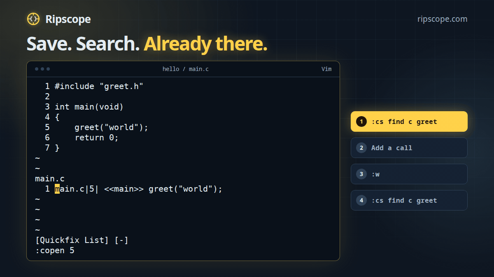

# Ripscope

[](https://github.com/pederbe/ripscope/actions/workflows/ci.yml)
[](https://ripscope.com/docs/)
[](#license)

Ripscope finds definitions, callers and assignments in C code, from Vim, Neovim,
Emacs or the command line. It is for people who read large or unfamiliar C and
want cscope's searches, much faster, with an index that keeps itself up to date.

```console
$ ripscope -R -L -1 greet          # where is greet defined?
greet.c greet 6 void greet(const char *name)
$ ripscope -L -3 greet             # who calls it?
main.c main 5 greet("world");
```

The examples here search the three small files of the
[example project](https://ripscope.com/docs/getting-started/example-project).

## Highlights

- **Fast.** On Linux, with 3,579 files of the Linux kernel, symbol, definition and
  caller lookups take about a tenth of a millisecond, hundreds of times faster
  than cscope. Text searches run about 6 times faster than `cscope -q` and assignment
  searches over 70 times.
- **Always current.** Save a file and search again. Ripscope reads only the files
  that changed, and a search never sees a half-updated index.
- **Fits where cscope fits.** It takes cscope's command line and prints cscope's
  rows, so Vim's `:cs find` and `cscope -Rbqk` scripts carry over.
- **No build setup.** One executable, written in safe Rust, reads your C as it is
  written. It needs no compiler, preprocessor or compile database.
- **Finds what cscope misses.** Increments, indexed stores and ordinary calls
  split across lines show up, and for specific constructs Ripscope corrects the
  function name cscope puts on a row.

Ripscope reads C only and runs on Linux and Windows. It does not expand macros or
resolve types, and it has no full-screen terminal interface.

## Installation

Linux

```sh
curl -fsSL https://ripscope.com/install.sh | sh
```

Windows, in PowerShell

```powershell
irm https://ripscope.com/install.ps1 | iex
```

The installer also sets up Vim and Neovim. For Emacs, and for Neovim with
lazy.nvim, it prints the one line to add to your configuration.

On Debian, Ubuntu, Fedora and RHEL-family systems you can install from the
[signed apt or dnf repository](https://ripscope.com/docs/guide/installation-options#apt-and-dnf-repositories)
instead and receive updates through your package manager.
[Other installation methods](https://ripscope.com/docs/guide/installation-options)
covers Cargo, standalone packages, archives and source builds. Downloads are on
the [latest release page](https://github.com/pederbe/ripscope/releases/latest).

If you would rather start from your editor, add one line to your plugin manager.
It installs the plugin and downloads the executable when it is missing.

```lua
{ 'pederbe/ripscope', branch = 'release', build = ':RipscopeInstall' },   -- Neovim, lazy.nvim
```

```vim
Plug 'pederbe/ripscope', { 'branch': 'release', 'do': ':RipscopeInstall' }  " Vim, vim-plug
```

```elisp
;; Emacs 30 or newer
(use-package ripscope :vc (:url "https://github.com/pederbe/ripscope" :branch "release" :lisp-dir "contrib/emacs" :rev :newest) :config (ripscope-setup))
```

Find callers in Vim, add and save a caller, then search again. The saved caller
is already in the results.



## Everyday use

### In your editor

Open a C file in your project and search for the definition of `main`.

| Editor | Search |
| --- | --- |
| Vim | `:cs find g main` |
| Neovim | `:RipscopeFind g main` |
| Emacs | `M-.` with the cursor on `main` |

The first search indexes the project into your cache directory. Later searches
see every edit you have saved. Helix and other editors that speak the Language
Server Protocol use `ripscope lsp`.

### On the command line

Run the first search with `-R` in your project directory, as the example at the
top does. It indexes the C files there and below, then answers. Later searches
bring the index up to date before they answer.

```console
$ ripscope -L -9 greet_count       # where is greet_count assigned?
greet.c greet 8 greet_count = greet_count + 1;
```

Each row is the file, the enclosing function, the line number and the source
line.

Search for text when the name is not a C symbol.

```console
$ ripscope -L -4 Hello
greet.c <unknown> 9     printf("Hello, %s!\n", name);
```

Get JSON for a script. It carries paths with spaces and every byte of the line.

```console
$ ripscope --json -L -3 greet
["main.c","main",5,"greet(\"world\");"]
```

The number after `-L` chooses the search.

| Search | Finds | Search | Finds |
| --- | --- | --- | --- |
| `-0` | every use of a symbol | `-5` | text, as in cscope's line mode |
| `-1` | definitions | `-6` | a regular expression |
| `-2` | functions called by a function | `-7` | files by name |
| `-3` | callers of a function | `-8` | files that include a file |
| `-4` | text | `-9` | assignments to a symbol |

| Option | What it does |
| --- | --- |
| `-L -N PATTERN` | Run search `N` and print the rows |
| `-R` | Include the C files in subdirectories |
| `-I DIR` | Look for included headers in `DIR` too |
| `-k` | Leave out the system headers in `/usr/include` |
| `-d` | Answer from the index as it is, without updating it |
| `-b` | Build or update the index without searching |
| `-f INDEX` | Use this index file instead of `ripscope.db` |
| `-l` | Keep running and answer one search per line, as editors do |
| `--json` | Print each row as a JSON array |
| `--verify` | Check the index |

Run `ripscope --help` for every option.

## Learn more

- [Installation](https://ripscope.com/docs/getting-started/installation), with
  how to check that it worked and every other way to install
- [Quick start](https://ripscope.com/docs/getting-started/quick-start) and a worked
  [example project](https://ripscope.com/docs/getting-started/example-project)
- Editor guides for [Vim](https://ripscope.com/docs/editors/vim),
  [Neovim](https://ripscope.com/docs/editors/neovim),
  [Emacs](https://ripscope.com/docs/editors/emacs) and the
  [language server](https://ripscope.com/docs/editors/language-server)
- [Switch from cscope](https://ripscope.com/docs/guide/switch-from-cscope) and the
  [differences from cscope](https://ripscope.com/docs/reference/differences-from-cscope)
- [Use Ripscope in scripts](https://ripscope.com/docs/guide/scripts)
- [Command reference](https://ripscope.com/docs/reference/cli) and
  [limitations](https://ripscope.com/docs/reference/limitations)
- [Benchmarks](https://ripscope.com/docs/reference/benchmarks) for every search on
  Linux and Windows
- [How Ripscope works](https://ripscope.com/docs/project/how-it-is-built)
- [Troubleshooting](https://ripscope.com/docs/help/troubleshooting)

Before 1.0, a minor version may change the index format or command-line behavior,
and the [changelog](CHANGELOG.md) says when it does. Bug reports, compatibility
reports and pull requests are welcome. See [CONTRIBUTING.md](CONTRIBUTING.md).

## License

Ripscope is licensed under either of [Apache License 2.0](LICENSE-APACHE) or
[MIT license](LICENSE-MIT), at your option. So are the editor integrations.

Ripscope is an independent project, not affiliated with
[cscope](https://cscope.sourceforge.net/). Its longstanding interface and
observable behavior are credited in the retained [cscope notice](evidence/CSCOPE-NOTICE.txt).
Third-party fixture source keeps its own copyright and license notices, listed in
the [evidence guide](evidence/README.md).
