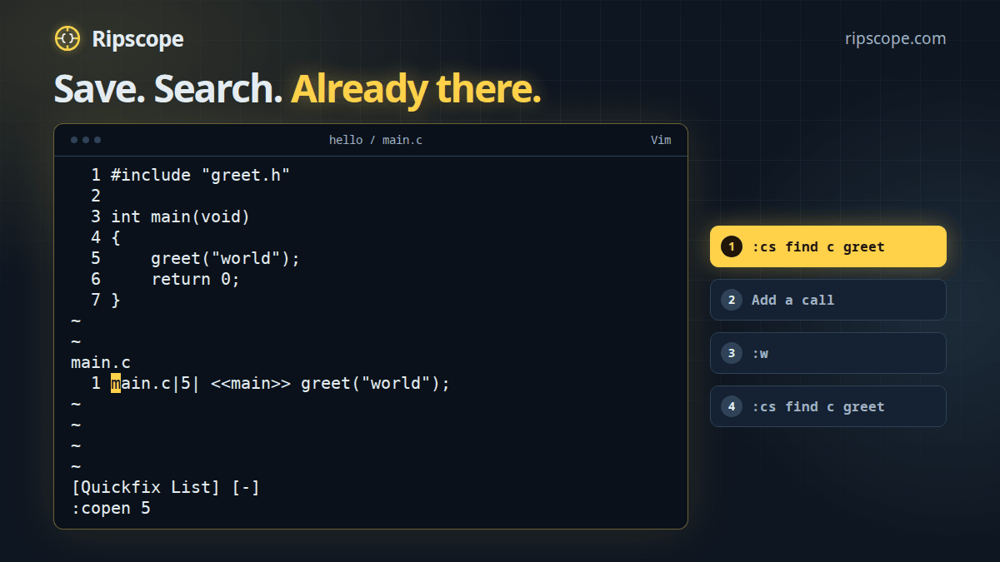

# Ripscope

[](https://github.com/pederbe/ripscope/actions/workflows/ci.yml)
[](https://ripscope.com/docs/)
[](#license)

**Fast C navigation, with answers you can inspect.**

Find definitions, follow callers and trace assignments in unfamiliar C. Ripscope
is written in purely safe Rust and needs no compiler, preprocessor or compile
database to read your source. It speaks cscope's command line and query protocol, works with
Vim's built-in cscope support and `cscope -Rbqk` scripts, and ships integrations
for Neovim and Emacs on x86-64 Linux and Windows.

```console
$ ripscope -bk -I include          # index the C files here
$ ripscope -L -1 greet             # where is greet defined?
greet.c greet 6 void greet(const char *name)
$ ripscope -L -3 greet             # who calls it?
main.c main 5 greet("world");
```

## Why Ripscope?

- **Fast, by a wide margin.** On the Linux kernel, symbol, definition and caller
  lookups return in about a tenth of a millisecond, hundreds of times faster than
  cscope. Even against cscope `-q`, text searches run about 6× faster, egrep 10×
  and assignment searches over 70×. See the [benchmarks](docs/reference/benchmarks.md)
  for every search on Linux and Windows.
- **Better reading of specific C constructs.** Find written increments and
  indexed stores, recognise ordinary split-line calls and correct mislabelled
  contexts. [Paired fixtures and source evidence](docs/reference/differences-from-cscope.md)
  show the intended readings and the limits.
- **An index that keeps up.** Only changed files are analysed again. Each update
  commits in one transaction, so queries keep reading a complete revision and
  editor searches refresh saved source changes automatically.
- **A design you can follow.** The [architecture guides](docs/architecture/overview.md),
  [decisions](docs/adr/README.md) and [glossary](CONTEXT.md) explain how a result is
  obtained.
- **Exact output when needed.** The opt-in JSON interface preserves path and line
  bytes, including spaces and non-ASCII text.

Ripscope reads written source across conditional branches. It does not expand
arbitrary macros or resolve types. See the [recognition limits](docs/reference/limitations.md)
and [freshness checks](docs/guide/recovery.md).

Find callers in Vim, add and save a caller, then search again. The saved caller
is already in the results.



## Your editor. Your source.

Use all nine cscope searches from the command line or directly in Vim, Neovim and
Emacs. Ripscope creates and manages the project index on x86-64 Linux and Windows,
so you can get straight to exploring C.

## Install

One step sets up Ripscope and your editor. Run the installer.

```sh
curl -fsSL https://ripscope.com/install.sh | sh        # Linux
irm https://ripscope.com/install.ps1 | iex             # Windows PowerShell
```

Vim then loads Ripscope by itself, and so does Neovim unless lazy.nvim manages its
plugins. For Emacs, and for lazy.nvim where it finds it, the installer prints the one
line to add. Or add one line to your plugin manager, which installs the executable
too.

```lua
{ 'pederbe/ripscope', branch = 'release', build = ':RipscopeInstall' },   -- Neovim, lazy.nvim
```

```vim
Plug 'pederbe/ripscope', { 'branch': 'release', 'do': ':RipscopeInstall' }  " Vim, vim-plug
```

```elisp
;; Emacs 30 or newer
(use-package ripscope :vc (:url "https://github.com/pederbe/ripscope" :branch "release" :lisp-dir "contrib/emacs" :rev :newest) :config (ripscope-setup))
```

Then open a C file in your project and search with `:cs find g main` in Vim,
`:RipscopeFind g main` in Neovim, or `C-c s g` in Emacs. The first search indexes
the project into your cache directory, and later searches see your saved edits.
See [installation](docs/getting-started/installation.md) for the details, system
packages and source builds.

## Use

| Task | Command |
| --- | --- |
| Build or update the index | `ripscope -b [-R] [-k] [-I DIR]... [FILES... \| -i LIST]` |
| Query (updates first) | `ripscope -L -FIELD PATTERN` |
| Query without updating | `ripscope -dL -FIELD PATTERN` |
| Editor session | `ripscope -l` |
| Exact output as JSON | add `--json` to a query or session |
| Check the index | `ripscope --verify` |

The index is `ripscope.db`, and `-f INDEX` names another.

| Field | Finds | Field | Finds |
| --- | --- | --- | --- |
| `-0` | symbol occurrences | `-5` | text (as in cscope's line mode) |
| `-1` | definitions | `-6` | regular expression |
| `-2` | functions called by | `-7` | files |
| `-3` | callers | `-8` | files including |
| `-4` | text | `-9` | assignments |

Start with the [quick start](docs/getting-started/quick-start.md). The
[Vim](docs/editors/vim.md), [Neovim](docs/editors/neovim.md) and
[Emacs](docs/editors/emacs.md) guides cover the editors.

## Documentation

The full documentation is at **[ripscope.com/docs](https://ripscope.com/docs/)**
and in [`docs/`](docs/README.md).

- [User guide](docs/guide/building.md) for building an index, queries, sessions, JSON and checking
- [Reference](docs/reference/cli.md) for the command line, differences from cscope and the FAQ
- [Architecture](docs/architecture/overview.md) and [design decisions](docs/adr/README.md)
- [Glossary](CONTEXT.md)

## Status

0.1.0 is the first release. Ripscope reads C only and runs on x86-64 Linux and
Windows. Before 1.0, a minor version may change the index format or command-line
behavior, and the [changelog](CHANGELOG.md) says when it does. Reports of wrong
answers and failed setups help most.

## Contributing

Bug reports, compatibility reports and pull requests are welcome. See
[CONTRIBUTING.md](CONTRIBUTING.md) and [how Ripscope is built](docs/project/how-it-is-built.md).

## License

Ripscope is licensed under either of [Apache License 2.0](LICENSE-APACHE) or
[MIT license](LICENSE-MIT), at your option. The Emacs integration in
[`contrib/emacs`](contrib/emacs) is GPL-2.0-or-later.

Ripscope is an independent project, not affiliated with
[cscope](https://cscope.sourceforge.net/). Its longstanding interface and
observable behavior are credited in the retained [cscope notice](evidence/CSCOPE-NOTICE.txt).
Third-party fixture source keeps its own copyright and license notices, listed in
the [evidence guide](evidence/README.md).
