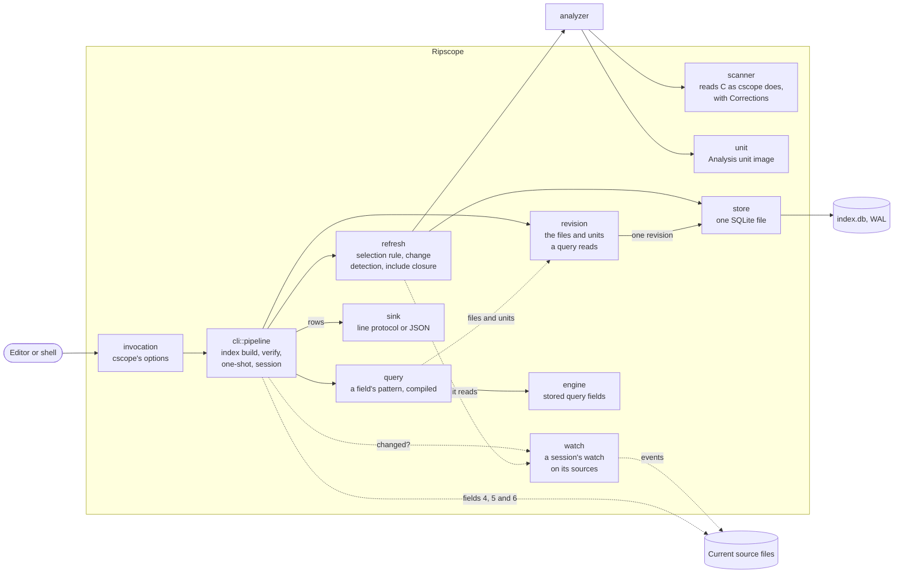
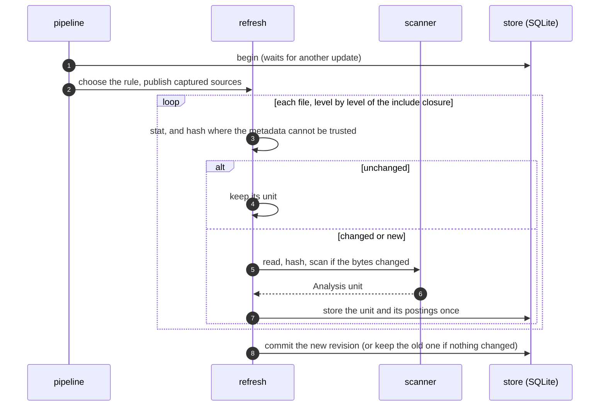
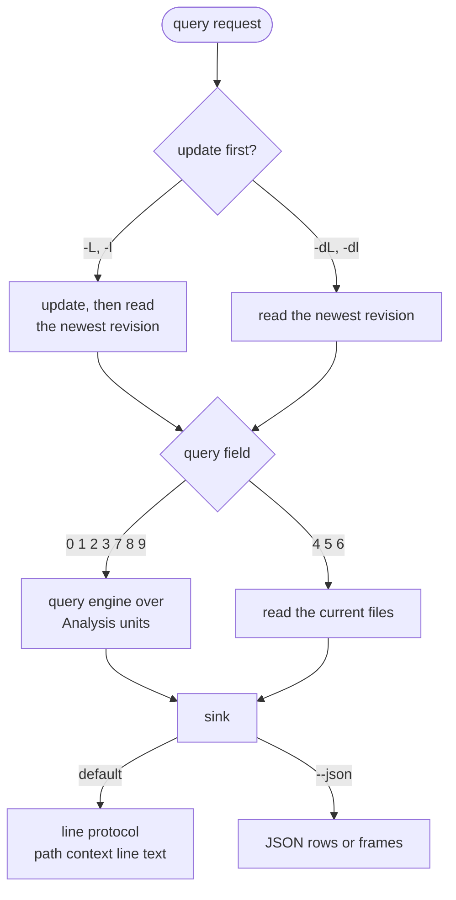

# Architecture overview

Ripscope is a single Rust executable. It reads C source files with its own scanner,
stores each file's **Analysis unit** (displayed lines and navigation facts) in one
SQLite file, and answers cscope's numbered queries from it, either one query per process
or through a long-running **session** that editors talk to.

This page is the map. Details live in:

- [How Ripscope reads C](reading-c.md): the scanner, matched to cscope's behaviour, and
  its Corrections.
- [How Ripscope answers stored queries](answering-queries.md): the query engine.
- [Index storage](storage.md): the SQLite file, updates and change detection.
- [Quality and compatibility method](quality.md): probes, the compass and Corrections.
- [Architecture decisions](../adr/README.md): why things are the way they are.

## Stack

| Concern | Choice |
| --- | --- |
| Language | Rust (2024 edition, stable toolchain), `unsafe_code = "forbid"` |
| Reading C | Ripscope's own scanner, matched to the pinned cscope ([ADR 0004](../adr/0004-own-scanner.md)) |
| Storage | [SQLite](https://sqlite.org/) via `rusqlite`, bundled, in WAL mode |
| Matching | `regex` (byte-oriented, cscope's pattern grammar translated) |
| Change detection | file metadata and identity, `sha2` hashes, and a session's watch through inotify on Linux and `notify` on Windows |
| Platform | `rustix` on Linux, `winx` and `notify` on Windows |
| Interfaces | cscope line protocol, JSON (`serde_json`), Vim, Neovim (Lua), Emacs (Lisp) |

Every dependency is pinned to an exact version and the lockfile is enforced with
`--locked`.

## Components

<!-- description: The command line sends builds through Refresh and the scanner into one SQLite index. Stored queries read one index revision, and text queries read current source files. Both return rows through the result sink. A session's watch learns from each Refresh what it reads and tells the session when the source files changed. -->

| Module | Responsibility |
| --- | --- |
| `invocation` | Reads a command line the way cscope reads its options, and refuses what Ripscope cannot honour. |
| `cli::pipeline` | Index builds, `--verify`, one-shot queries and sessions. Frames answers, prompts and requests that cannot be answered. |
| `refresh` | Applies the selection rule, detects changed files, analyses them and follows `#include`s, then publishes one revision. |
| `refresh::includes` | Owns effective include search directories and lookup caches for one Refresh, and records what it asked the file system so a later Refresh can ask again. |
| `watch` | A session's Watch: covers what each Refresh reads before it reads it (inotify on Linux, `ReadDirectoryChangesW` on Windows) and tells the session before each query whether a Refresh could find anything changed (ADR 0008). |
| `analyzer` | The Analyzer: reads a captured source into its Analysis unit with a set of Corrections, and names itself, so an index knows which analyses it holds. |
| `scanner` | Turns a file's bytes into cscope's line records. Corrections are switchable readings at named decision points. |
| `unit` | The Analysis unit: a file's displayed lines and ordered navigation events, as one validated image. |
| `store` | The one SQLite file: selection rule, files in database order, shared units, include operands. |
| `revision` | The index revision a query reads: the indexed files in database order and their Analysis units, read from the index in one transaction or made in memory for the compass and tests. It is the one place queries read a revision. |
| `query` | Compiles a query field's pattern with the product's limits, as a stored query or a live text query, and gives a stored query's Result rows with their context column. |
| `engine` | Answers fields 0, 1, 2, 3, 7, 8 and 9 over Analysis units with Ripscope's own query semantics, and keeps cscope's sequential search as the oracle. |
| `sink` | Encodes, counts and spools result rows in their output order, and places answer warnings for each reader. |

## Updating an index

An index build (`-b`), a query without `-d`, a session's `r` and an updating session's
query after its Watch reports a change all bring the index up to date the same way: one
SQLite transaction that holds the write lock from start to commit. A Refresh tells the
Watch its rule and starting revision before it reads any file, and what the revision it
leaves holds.

After applying file-list options, Refresh constructs one private Include resolver.
Discovery returns canonical indexed spellings in cscope's build-root and include-directory
order, stopping at already-listed paths. It asks the file system only whether a
candidate is a regular file spelled exactly (through directory listings on Windows), and
its caches start fresh for each Refresh. Each file is read from its own bytes, without
the headers it includes ([ADR 0003](../adr/0003-read-source-as-written.md), "Each file is
read as written, without a compiler or preprocessor"), so only a file whose bytes
changed is analysed again.

<!-- description: Refresh holds one write transaction, keeps unchanged Analysis units, scans changed sources and stores their units before committing. Readers retain their existing revision until their next query. -->

Readers keep the revision they started with while an update runs, and a session sees
the new one at its next query.

## Answering a query

<!-- description: Queries update first unless -d is set. Stored fields read Analysis units and text fields read current source files. The result sink formats either cscope rows or JSON. -->

The result sink spools answers, so their row count and any warnings are known before the
first row is written. It keeps rows at file scope before the other rows, including when
several threads answer parts of a query. Each of its two streams keeps up to 8 MiB in
memory for a complete answer, or 1 MiB for a part, then spills to a temporary file.

The transport supplies the result header. The sink writes answer warnings to stderr
before that header for line sessions and one-shot queries (including one-shot JSON), or
as warning frames after the rows in JSON sessions. Vim's short notice and RETURN
acknowledgement remain session framing. A failure while finding or spooling rows delivers
no partial answer, and a failure while writing the finished answer stops delivery.

## Where to look in the code

| Question | Start at |
| --- | --- |
| How arguments are read | `src/invocation.rs` |
| Index builds, queries, sessions | `src/cli/pipeline.rs`, `src/cli/pipeline/` |
| Reading C | `src/scanner/` |
| The index file | `src/store.rs` |
| Updates and the include closure | `src/refresh.rs` |
| Query fields | `src/query.rs`, `src/engine.rs`, `src/query/pattern.rs` |
| What a query reads from the index | `Reads` in `src/engine.rs`, `src/revision.rs` |
| Output | `src/sink.rs` |
